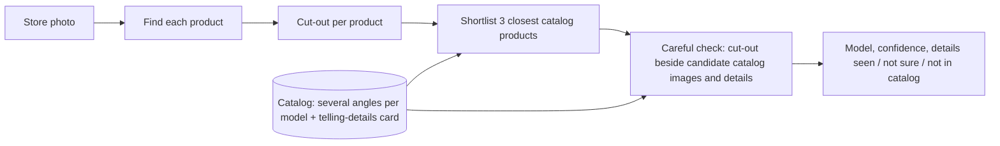

# Product brief: Dyson store-photo matching MVP

## Facts
| Fact | Value | Status |
|---|---|---|
| Who uses it | Field staff photograph store displays; the AI CoE capstone team (Prince Vishwari, Vipul Tyagi) builds the app | decided 2026-10-15 (call transcript) |
| Who sees the MVP | Shiva shows a demo and an accuracy report to the team early next week; their developers rebuild it in their app | decided 2026-10-15 |
| Product scope | Dyson only. TV sticker check and washing machines later | decided 2026-10-15 |
| Data | Dyson catalog images from Dyson's website, store photos from the public web; rerun on the team's images when they arrive | decided 2026-10-15 |
| Most common action | Staff upload one store photo; the system names every Dyson product in it | assumed: from the call |
| Must never go wrong | Naming the wrong model with high confidence (V8 reported as V12) | assumed: the failure the team reported |
| When unsure | Say "not sure" and show the top two guesses | decided 2026-10-15 |
| Photos per day | Unknown | decided 2026-10-15: Shiva not sure; the MVP measures cost per photo |
| Approach | Shiva asked for the approach to be researched and chosen, using current vision models | decided 2026-10-15 |
| Sensitive data | None; product photos | assumed |

## Confirmed MVP interview, 15 October 2026

Shiva confirmed that the team will choose the approach and model to prototype next. The demo must accept a new photo locally and show each result. The report will be presented on screen, with every test result below. Total API spending, including reruns, must not exceed INR 2,000. The approach is under research review before step 2.

## Client workflow clarification, 15 October 2026

Shiva confirmed that both matching situations occur: some store photos have a known expected model, while others require identifying products from the manufacturer catalogue. Multiplier receives manufacturer brochures and images. Store photo quality and camera angle are unreliable, although staff can be asked to take another photo. Accuracy is the primary goal; no numerical acceptance target has been set. These requirements apply to the same MVP and do not authorise a production build.

## Story
Ramesh, a field merchandiser, photographs the Dyson wall at a Croma store: a V8, a V12 and a V15 on one stand, a purifier behind them, price tags and glare in the frame. Later he photographs a Big Ball from the side, which matches no catalog angle. Next week a new Dyson model arrives in the store before anyone has added it to the catalog.

## Walk
| Moment for Ramesh | What goes wrong with the simplest design (whole photo vs one catalog image) | What we add | When |
|---|---|---|---|
| Photographs three vacuums on one stand | One score for the whole photo; two products are never matched | Find each product in the photo and cut it out | Now |
| V12 and V15 sit side by side | Both look about 90% similar to either catalog photo | A short list of the closest catalog products, then one model call that sees the cut-out beside each candidate's catalog images and picks one or none | Now |
| Purifier and a competitor's vacuum in the frame | Forced into the nearest Dyson model | "Not in catalog" as an allowed answer | Now |
| Big Ball photographed from the side | The single catalog image shows the front only | Several catalog angles per model | Now |
| Blurry or half-hidden product | A confident wrong guess | "Not sure", with the reason and the top two guesses | Now |
| Thousands of photos a day | One large model call per catalog product gets expensive | A cheap similarity shortlist, so the careful check sees three candidates | Now |
| A new model arrives | Retraining would be needed | Add its catalog images; nothing is retrained | Now |
| A newer vision model is released | Nothing breaks, but nobody knows whether it is better | Swap the model name and rerun the saved test set; switch only if the score improves | Now |
| The team confirms store photos by hand | Unused | Add confirmed store crops to that product's reference photos; nothing is trained | Now |

## Design

## Stack
Recommended: Gemini 3.8 Flash finds products; Gemini Embedding 2 builds the shortlist; the careful check runs on Gemini 4 Argon, GPT-5.5 and GPT-6.1 Sol over the same cut-outs, and the report picks the winner on accuracy and cost. A written "telling details" card per model runs as one variant of the check, so the report shows whether it helps. Reason: the team already uses Gemini, nothing needs a GPU server, and Gemini Embedding 2 scored 68.7% first-choice and 89.3% top-five without training on a published supermarket benchmark with about nine catalog images per product (Cat2Real, arXiv 2607.09888, July 2026).

Evaluation: the team's current method (whole photo against one catalog image, Gemini similarity score) runs first on the same test set as the "before" number. Each test photo's correct model comes from its source (listing title, review caption, retailer page), recorded with its URL. Catalog and test images come from separate sources. The test set includes lookalikes and non-Dyson products.

Jev: Shiva reopened its possible role on 15 October 2026. Current TypeSafe documentation describes experimental image input in Jev 1.14. Its role remains under discussion; no additional judge is approved or implemented. See `docs/approach-review-2026-10-15.md`.

Runner-up: SAM 3 to find products and DINOv3 for the shortlist, run on a rented GPU. It is cheaper per photo at very high volume, but needs a GPU server, and untrained DINOv3 scored lower (53.8% first-choice) on the same benchmark.

No training anywhere: Shiva ruled it out on 2026-10-15 because models keep changing and the team has thousands of products.

## Deferred
- TV sticker check, washing machines.

## Approved step-4 revision, 15 October 2026
The owner approved the engineering proposal and asked to bundle likely improvements. Step-4 spending ceiling is INR 400, with the INR 2,000 overall limit retained. Run shared detection, padded crops with context, multiple reference views, Embedding 2 retrieval and evidence-based checking together; compare independent cheap checkers and their combination, including the telling-details variant. Keep the baseline available alongside experimental results. The local demo must support both a known expected product and catalogue identification; insufficient evidence should lead to a specific retake request. A later client-store-photo rerun is needed to judge performance on the actual workflow. No further product judgement is needed before this contained experiment.

The owner added higher Gemini comparisons and then removed Gemma. Active check models are Qwen3.7 Flash (completed cheap comparison), Gemini 4 Argon, Gemini 3.1 Pro Preview, GPT-6.1 Sol and GPT-5.5. Further calls use the higher models. Gemma charges remain in the experiment total, and its answers are excluded from recommendations.
