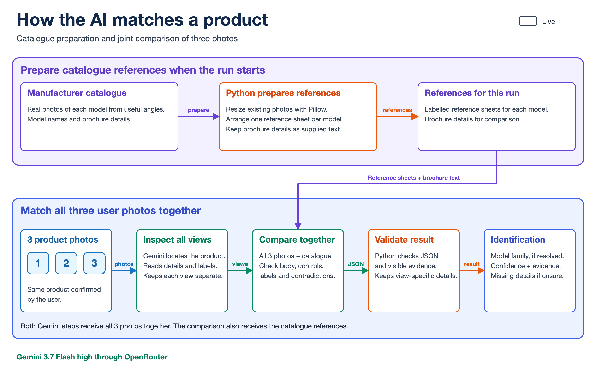
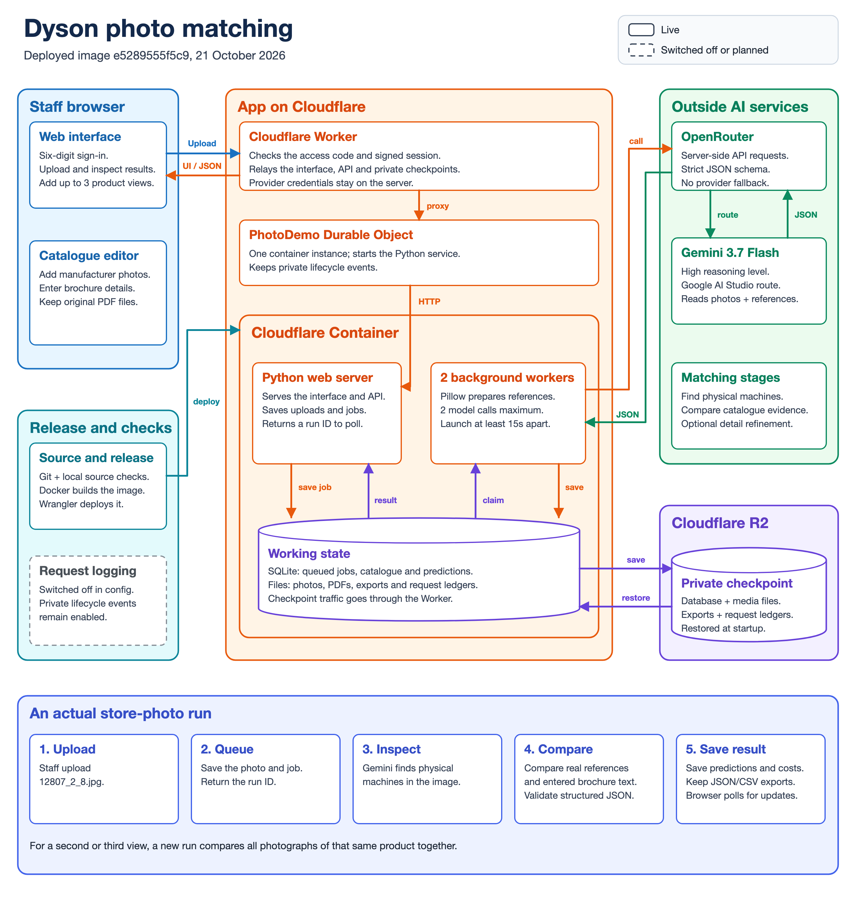

# Multiplier photo matching

Identify Dyson product families from store photographs by comparing them with manufacturer images and brochure details. Start with one photo, then add a second and third view of the same product for a joint identification with confidence and visible evidence.

[Open the hosted demo](https://multiplier-photo-demo.shiva-research11.workers.dev/). Sign in with the access code supplied separately, then choose **Take a platform tour** for a guided walkthrough.

## Try an identification

1. Open **Identify products**, select a JPEG, PNG or WebP photograph and start the comparison. Selecting a file alone does not start a paid model call.
2. Inspect the result: the product family, confidence, marked regions, supporting evidence and any missing details.
3. For a completed Identify result containing one machine, choose **Add another view**. Select another angle, confirm that it shows the same physical product and choose **Identify using 2 views**.
4. Repeat with a third angle and choose **Identify using 3 views**. The model compares all accumulated photos together. Earlier results remain saved so you can compare the outcomes.
5. Open **Saved results** to revisit a run or download its JSON and CSV exports.

An initial batch upload creates separate photo jobs. **Add another view** combines photos of one product into a joint run. Additional views may resolve an uncertain identity, but confidence can also remain unchanged or decrease. Confidence is the model's judgement, not a measured accuracy percentage.

Choose **Verify** when you want to check a claimed catalogue model rather than ask the app to identify it.

## How the AI pipeline works

Python uses Pillow to resize the real manufacturer photos and arrange a labelled reference sheet for each model. Brochure details are supplied as text. Reference sheets are currently prepared for each run.

For a three-view identification, both Gemini calls receive all three user photos together. The first locates the product and reads visible details; the second also receives the catalogue references and compares the product's body, controls, identifiers and cross-view consistency. Python then validates the structured JSON and evidence before saving one joint result.

[](docs/architecture/ai-pipeline.svg)

[Open the editable pipeline SVG](docs/architecture/ai-pipeline.svg) · [Open the full-resolution PNG](docs/architecture/ai-pipeline.png)

## Manufacturer catalogue

The initial catalogue covers these six product families:

| Product family | Catalogue entry |
| --- | --- |
| Dyson Big Ball | `dyson_big_ball` |
| Dyson V8 Absolute family | `dyson_v8_absolute` |
| Dyson V12 Detect Slim | `dyson_v12_detect_slim` |
| Dyson V15 Detect | `dyson_v15_detect` |
| Dyson V16 Piston Animal | `dyson_v16_piston_animal` |
| Dyson WashG1 | `dyson_wash_g1` |

V11, Gen5detect and Shark Stratos references help distinguish similar products outside that catalogue.

Use **Manufacturer catalogue** to add or edit a product's model name, manufacturer images and source-backed brochure details. Uploaded PDFs are stored as original attachments; this MVP does not automatically extract their contents. Enter the relevant details in the brochure text field. **Dataset guide** explains the expected reference and evaluation inputs.

Each run retains a fixed catalogue snapshot. Adding another product view uses that same snapshot, and later catalogue edits do not rewrite earlier results or exports.

## System architecture

A Cloudflare Worker checks sign-in and forwards the interface and API requests through the **PhotoDemo Durable Object** to one Python container. Two background workers process the saved SQLite queue. Gemini 3.7 Flash with high reasoning runs through OpenRouter's Google AI Studio route.

The container holds the working database, media, exports and request ledgers. Private Cloudflare R2 checkpoints preserve that state for restoration at startup. The browser polls for progress, so closing the browser does not cancel a running job.

[](docs/architecture/system-diagram.svg)

[Open the editable architecture SVG](docs/architecture/system-diagram.svg) · [Open the full-resolution PNG](docs/architecture/system-diagram.png)

The [deployment record](docs/cloudflare-demo-status.md) contains release and recovery evidence. The [diagram maintenance note](docs/architecture/DIAGRAM-STYLE.md) explains how to keep both diagrams consistent with the source.

## Run locally

You need Python 3.11 or newer and an OpenRouter API key with access to the configured model. Clone this private repository while signed in to GitHub as an authorised user:

```bash
git clone --branch codex/local-app https://github.com/Shivak11/dyson-matching-mvp.git
cd dyson-matching-mvp
python3 -m venv var/venv
source var/venv/bin/activate
python -m pip install -r requirements.txt
python tools/build_private_app.py --output . --prepare-catalogue --inputs-only
```

The preparation command copies manufacturer references into `var/catalogue-seed` and writes the ignored `runtime_config.json`. It preserves an existing catalogue database and does not copy evaluation photographs or answer labels into the app inputs.

Set `OPENROUTER_API_KEY` in the server environment or in an ignored `.env` file at the repository root. Then start the app:

```bash
python app_server.py --port 8768
```

Open [the local app](http://127.0.0.1:8768). Local mode binds to the loopback address and stores its database, uploads and results under `var/`.

## Spending and recovery

The configured shared runtime cap is ₹700. The app records charges and unfinished-request reservations per job. At most two provider requests run in parallel, with at least 15 seconds between launches. There is no silent model or provider fallback.

Queued work survives a hosted restart through the R2 checkpoint. Running work resumes only when its saved requests and successful responses establish a safe continuation. Unknown provider outcomes remain interrupted with their reservations retained. Completed JSON and CSV exports preserve the recorded result.

Credentials, access codes, runtime configuration, databases and client uploads are excluded from Git. Hosting uses Worker secrets; the browser receives no provider key. Docker builds the container image locally, and the pinned Wrangler procedure deploys it to Cloudflare.

## Checks and evaluation

Run the offline source checks with the local environment active:

```bash
python -m unittest discover -s tests -v
```

To check just the facts and image dimensions of both diagrams:

```bash
python -m unittest discover -s tests -p 'test_*diagram.py' -v
```

These checks do not call paid models. Measured identification outcomes are recorded separately:

- [Cumulative-view example](docs/multiple-views-review.md): one V15 example checked with one, two and three views.
- [Store-photo and owner-review checks](docs/store-photo-ui-review.md): noisy photographs and source-labelled review frames.
- [Historical accuracy report](web/report.html): the earlier full-set comparison, costs and development photographs; open the HTML file locally.
- [Queue and worker repair](docs/breaker-repair-20261021.md): failure-recovery checks and the hosted completion record.

The historical report and evaluation material are retained in the research repository. The hosted app excludes the report, test photographs and answer labels from its served files and inference inputs.
